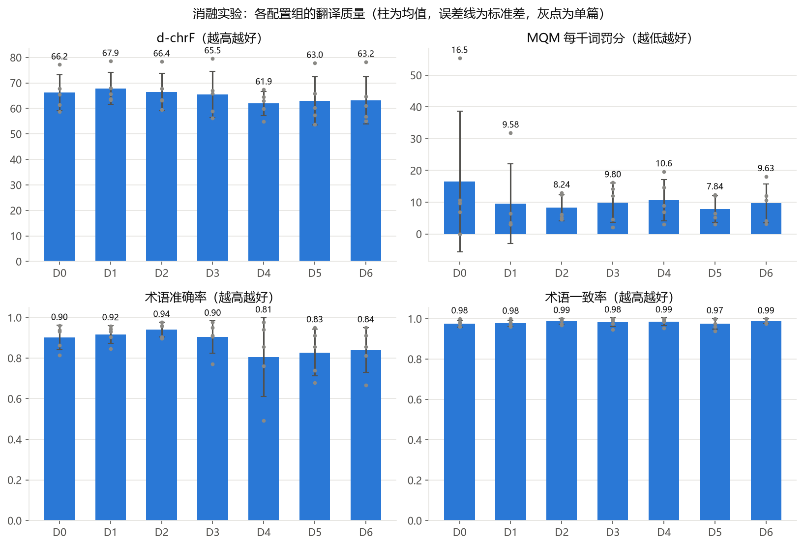
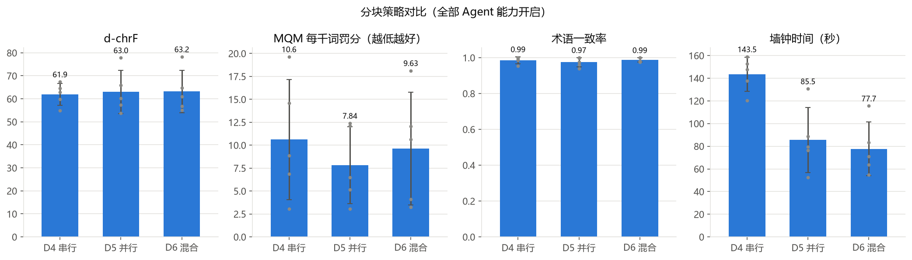
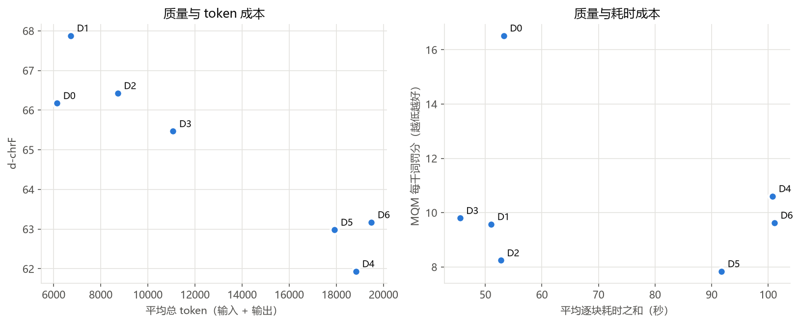
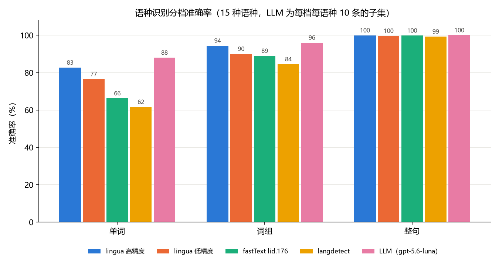
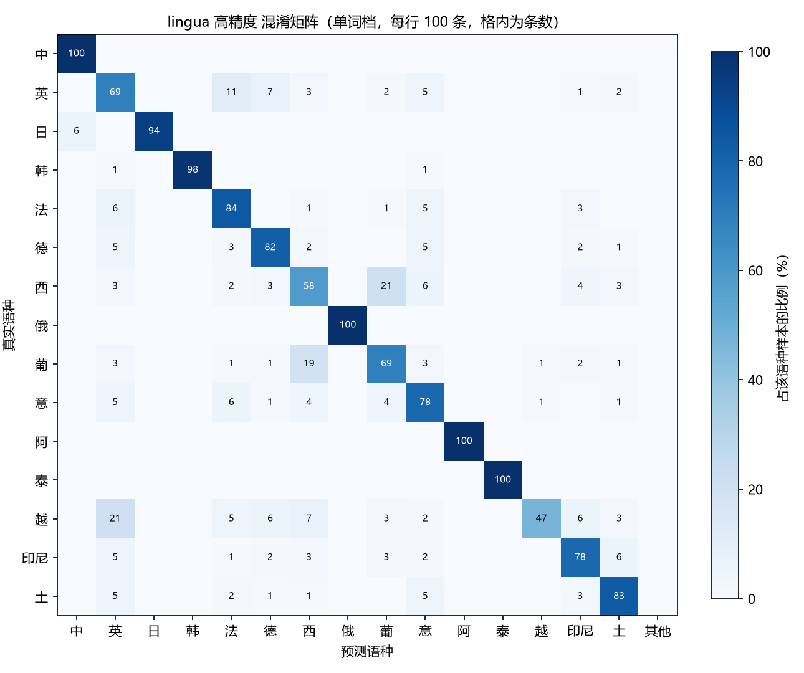
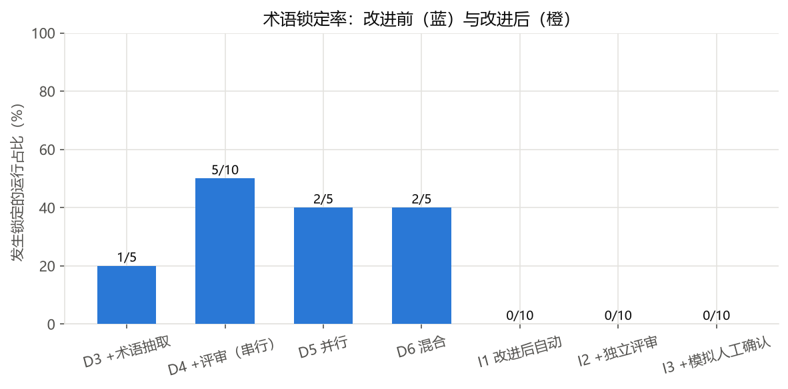
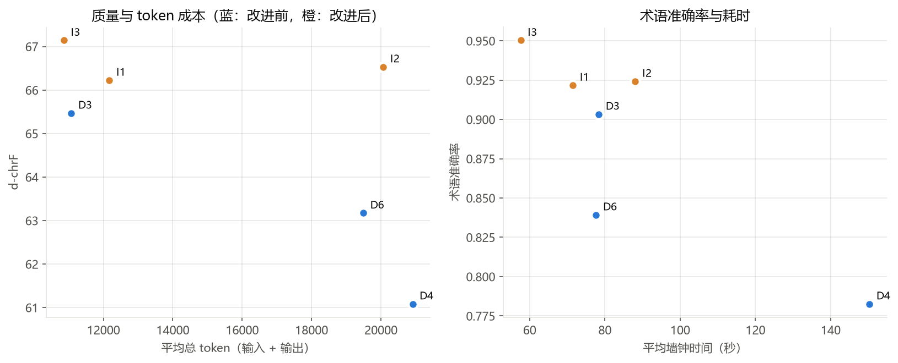
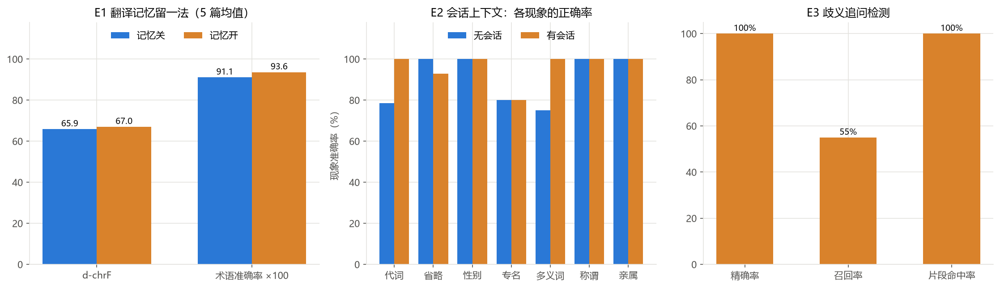
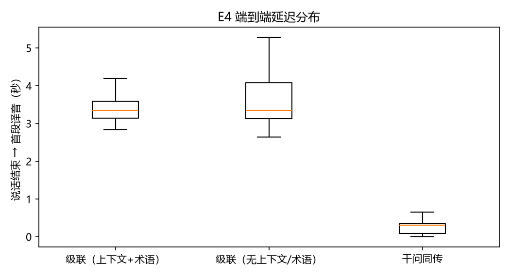
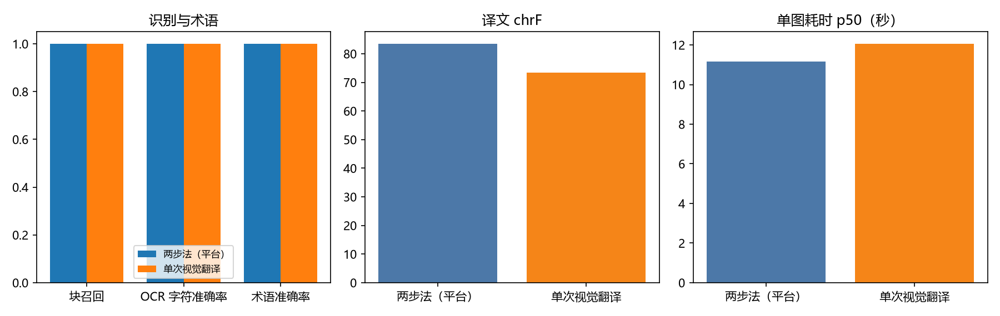

# 实验报告：基于 Agent 的多语言翻译平台评测

> 实验日期：2026-10-03 · 代码版本：`5539651`（实验执行）· 评测工程：`evaluation/`（黑盒驱动平台对外接口）；改进验证（第 9 节）：`baf1ca1`；会话与翻译记忆（第 10 节）：`6e863ad`
> 原始数据：`evaluation/results/`（每次运行一个 JSON，可复核）；图表：`docs/experiments/figures/`

## 1. 实验目的

本实验回答三个问题：

1. **各项 Agent 能力分别带来什么**：前块上下文、全文摘要、术语抽取、评审修正，各自对译文质量与成本的影响
2. **分块执行策略的取舍**：串行、并行、混合三种策略的质量与速度
3. **平台的工程性能**：语种识别器的选型依据，以及本地单机下的吞吐与延迟

## 2. 实验设置

### 2.1 测试集

| 测试集 | 来源 | 规模 | 用途 |
|---|---|---|---|
| 篇章级 | kubernetes/website（commit `192e45e7`）5 篇概念文档的英文原文与官方简体中文译文，清洗短代码、注释与 front matter，按二级标题截取 | 英文 3719–7747 字符，共 3400 词 / 15 块 | 消融与策略实验 |
| 金标术语 | 依据参考译文人工整理 | 每篇 14–18 条，共 78 条，覆盖 527 次术语出现 | 术语指标 |
| 句子级 | FLORES-200 devtest eng_Latn→zho_Hans 前 100 句 | 100 句 | 快速路径与标准路径对比 |
| 语种识别 | FLORES-200 devtest 15 种语种 × 单词 / 词组 / 整句三档 × 100 条（固定种子） | 4500 条 | 识别器对比 |

### 2.2 模型与配置

- 译者：`gpt-5.6-luna`（OpenAI 兼容中转，平台模型配置 id=2），平台默认参数
- MQM 评审：`gpt-6-luna`（与译者不同），temperature 0，GEMBA-MQM 风格无参考评审，按块评审
- 文档任务一律不使用术语库、不人工确认术语（自动采纳抽取结果），目标语言中文

| 组别 | 前块上下文 | 全文摘要 | 术语抽取 | 评审修正 | 策略 |
|---|---|---|---|---|---|
| D0 逐段独立 | ✗ | ✗ | ✗ | ✗ | 并行 |
| D1 | ✓ | ✗ | ✗ | ✗ | 串行 |
| D2 | ✓ | ✓ | ✗ | ✗ | 串行 |
| D3 | ✓ | ✓ | ✓ | ✗ | 串行 |
| D4 | ✓ | ✓ | ✓ | ✓ | 串行 |
| D5 | ✓ | ✓ | ✓ | ✓ | 并行 |
| D6 | ✓ | ✓ | ✓ | ✓ | 混合 |

每篇文档每组运行 1 次，D4 额外重复 1 次以估计随机波动，共 40 次运行，**全部成功，无重试**。

### 2.3 指标

| 指标 | 说明 |
|---|---|
| d-chrF / d-BLEU | 整篇译文相对官方参考译文（sacrebleu，BLEU 按字切分）。参考译文是本地化改写，绝对值偏低，关注组间差异 |
| MQM 罚分 | 每千源词罚分，critical 25 / major 5 / minor 1，越低越好 |
| 术语准确率 | 金标术语每次出现时，对应译文段落是否使用金标译法（按出现次数比对，屏蔽"可部署"等子串误判） |
| 术语一致率 | 每条术语最常用译法所占比例的平均 |
| 成本 | prompt + completion token；墙钟时间 |

## 3. 消融实验结果

### 3.1 各组均值（5 篇，run 1）

| 组别 | d-chrF | d-BLEU | MQM 罚分 ↓ | MQM major 错误数 | 术语准确率 | 术语一致率 | token | 墙钟时间 |
|---|---|---|---|---|---|---|---|---|
| D0 逐段独立 | 66.2 | 59.9 | 16.5 | 11 | 0.901 | 0.976 | 6.1k | 28.4 s |
| D1 + 前块上下文 | **67.9** | **61.3** | 9.6 | **2** | 0.916 | 0.977 | 6.7k | 51.8 s |
| D2 + 全文摘要 | 66.4 | 60.2 | 8.2 | 2 | **0.939** | **0.987** | 8.7k | 59.8 s |
| D3 + 术语抽取 | 65.5 | 60.0 | 9.8 | 3 | 0.903 | 0.982 | 11.1k | 78.4 s |
| D4 + 评审修正（串行） | 61.9 | 57.7 | 10.6 | 3 | 0.805 | 0.985 | 18.8k | 143.5 s |
| D5 全部（并行） | 63.0 | 58.8 | **7.8** | 1 | 0.827 | 0.975 | 17.9k | 85.5 s |
| D6 全部（混合） | 63.2 | 58.9 | 9.6 | 2 | 0.839 | 0.987 | 19.5k | 77.7 s |



**随机波动**：D4 两次运行的逐篇平均绝对差为 chrF 3.3、MQM 14.3、术语准确率 0.079。因此单次运行下，**chrF 小于约 3 分、术语准确率小于约 0.08 的组间差异不具备统计意义**；MQM 在本测试集规模下（每篇 3 块左右）波动很大，只作为辅助参考，以 major 错误数等计数为主。

### 3.2 逐篇明细

d-chrF：

| 文档 | D0 | D1 | D2 | D3 | D4 | D5 | D6 |
|---|---|---|---|---|---|---|---|
| configmap | 67.8 | 68.0 | 67.7 | 67.0 | 67.4 | *57.3* | *56.8* |
| deployment | 77.2 | 78.5 | 78.4 | 79.6 | *63.0* | 77.8 | 78.3 |
| pods | 65.5 | 65.6 | 63.4 | 65.8 | 64.6 | 65.9 | 64.7 |
| service | 61.5 | 63.7 | 63.1 | *56.1* | *54.9* | *53.7* | *55.1* |
| volumes | 58.8 | 63.4 | 59.6 | 58.9 | 59.9 | 60.2 | 61.0 |

术语准确率：

| 文档 | D0 | D1 | D2 | D3 | D4 | D5 | D6 |
|---|---|---|---|---|---|---|---|
| configmap | 0.931 | 0.943 | 0.977 | 0.977 | 0.977 | *0.678* | *0.667* |
| deployment | 0.863 | 0.904 | 0.904 | 0.911 | *0.493* | 0.911 | 0.911 |
| pods | 0.814 | 0.845 | 0.897 | 0.907 | 0.856 | 0.856 | 0.856 |
| service | 0.938 | 0.958 | 0.958 | *0.771* | *0.760* | *0.740* | *0.812* |
| volumes | 0.960 | 0.931 | 0.960 | 0.950 | 0.941 | 0.950 | 0.950 |

斜体为发生"术语锁定"（见 3.3）的运行。可以看到，D3–D6 的均值下降几乎全部来自这些运行，其余运行与 D1、D2 持平。

### 3.3 关键发现

**发现 1：前块上下文显著减少严重错误。** 从 D0 到 D1，MQM major 错误从 11 个降到 2 个（−82%），MQM 罚分从 16.5 降到 9.6，chrF +1.7，而 token 只增加约 9%。逐段独立翻译的典型错误是跨段指代与省略主语被误译，上下文正好弥补这一点。这是**性价比最高**的一项能力。

**发现 2：全文摘要提升术语准确率与一致率。** D2 的术语准确率（0.939）与一致率（0.987）在所有组中最高，说明摘要提供的领域与主题信息帮助模型选对术语。代价是增加一次摘要调用，token +30%。

**发现 3：自动术语抽取存在"锁定"效应。** 在开启术语抽取的 25 次运行中，有 **10 次（40%）** 至少把一个按 Kubernetes 中文惯例应保留英文的资源名译成了中文，例如 `Deployment→部署`、`ReplicaSet→副本集`、`ConfigMap→配置映射`、`Service→服务`。由于实验关闭了人工确认，这一译法被写入任务术语表并**强制应用到全文**：

- deployment × D4 中 38 处 Deployment 全部译为"部署"，术语一致率仍高达 0.985，但金标准确率跌到 0.493，chrF 跌到 63.0
- 发生锁定的运行平均 chrF 56.7 / 术语准确率 0.703，未发生锁定的运行为 67.0 / 0.919

术语抽取机制本身确实做到了它的设计目标（全文一致），但"一致地错"的代价同样被放大。抽取结果在不同运行间并不稳定（同一篇文档有时保留英文、有时译成中文），这是**平台提供"人工确认术语"环节的直接依据**：由人在翻译开始前纠正一次，就能避免全文性的偏差。在排除锁定运行的辅助分析中，D3、D5、D6 的 chrF 均回到约 68，术语准确率约 0.91–0.94（注意：排除后各组的文档构成不同，仅作参考）。

**发现 4：评审修正极少触发，收益不明显。** 在开启评审的 60 个块中，只有 **4 块（6.7%）** 触发了修正（D4 第二轮 3 块、D6 1 块）；句子级实验中修正触发率为 5%。评审本身使 token 增加约 70%（D3 11.1k → D4 18.8k），墙钟时间增加约 83%，但质量没有可测量的提升。D3 到 D4 的 chrF 下降并非评审造成：D4 第一轮没有任何块被修正，差异来自随机波动与术语锁定。原因推测是评审与翻译使用同一模型，自评偏宽松，85 分的阈值几乎拦不住译文。

**发现 5：并行与混合策略大幅缩短时间，质量无显著差异。** 在全部能力开启的条件下，墙钟时间从串行的 143.5 s 降到并行 85.5 s（−40%）、混合 77.7 s（−46%）；chrF、术语一致率的差异落在随机波动范围内。并行策略理论上会因块间不共享上下文而损失连贯性，但在本测试集（每篇约 3 块、块内段落较完整）上没有观察到，混合策略兼顾了两者。





### 3.4 对平台的改进建议

1. **默认开启人工确认术语**，并在术语抽取提示词中加入领域惯例（例如"Kubernetes 资源名保留英文"）；或允许管理员为领域配置"保留原文"的术语白名单
   —— **已落实**（⑥）：人工确认默认开启；抽取提示词加入通用领域惯例（未写领域专用规则）；另外把未经确认的抽取术语降为软约束。白名单未单独实现，可用"译法与源词相同"的术语库条目代替。效果见第 9 节
2. **提高评审的有效性**：使用与译者不同的评审模型，或把通过阈值从 85 提高到 90，并按 MQM major 错误而不是总分决定是否修正；在成本敏感的场景默认关闭评审
   —— **已落实**（⑥）：新增全局评审模型；修正改为按严重度决定（critical/major、硬术语未遵循或低于兜底分 75）；文档默认关闭评审。效果见第 9 节
3. **默认策略改为混合**：在质量相当的前提下节省约一半时间 —— **已落实**（⑥）
4. 前块上下文与全文摘要成本低、收益稳定，应始终开启 —— 保持默认开启

## 4. 句子级实验（FLORES-200，100 句）

| 路径 | chrF | BLEU | 修正触发率 | 平均首轮评审分 | 平均 token / 句 | 平均耗时 / 句 |
|---|---|---|---|---|---|---|
| 快速路径 | 42.7 | 49.1 | — | — | 332 | 4.4 s |
| 标准路径（含评审修正） | 42.4 | 49.1 | 5% | 94.9 | 1515 | 14.3 s |

在新闻类单句上，标准路径的质量与快速路径没有差别，成本约为快速路径的 4.6 倍、耗时约 3.2 倍。这与篇章级的发现 4 一致，也说明平台 `mode=auto` 对短句默认走快速路径的设计是合理的。（FLORES 的 chrF 绝对值偏低，是因为参考译文为单一人工译本且中文 chrF 对措辞差异敏感。）

## 5. 语种识别对比

| 识别器 | 单词 | 词组 | 整句 | 总体 | 吞吐（条/秒） |
|---|---|---|---|---|---|
| lingua 高精度（平台采用） | 82.7% | 94.4% | 99.9% | 92.3% | 2,969 |
| lingua 低精度 | 76.5% | 90.0% | 99.7% | 88.7% | 3,439 |
| fastText lid.176 | 66.2% | 88.9% | 99.8% | 85.0% | 33,678 |
| langdetect | 61.6% | 84.5% | 99.3% | 81.8% | 223 |
| LLM（gpt-5.6-luna，450 条子集） | 88.0% | 96.0% | 100% | 94.7% | 2.4 |



- 整句档所有识别器都在 99% 以上，差距集中在短文本：单词档 lingua 高精度比 fastText 高 16.5 个百分点，比 langdetect 高 21 个百分点
- LLM 在短文本上最准，但速度慢三个数量级（每批 25 条约 10.6 s）
- 主要混淆：lingua 为葡萄牙语↔西班牙语、越南语→英语；fastText 为印尼语 / 越南语→英语、中文→日语，另有 143 条预测落在支持范围之外；langdetect 把 2–4 字的中文短串误判为韩语 79 次
- **结论**：平台"lingua 为主、置信度低于 0.5 或少于 4 个字符时交给 LLM 兜底"的组合，兼顾了准确率与速度，本实验为这一设计提供了数据支持



## 6. 性能测试

环境：Windows 11 单机，Spring、Python AI 服务、PostgreSQL、Redis、Locust 同机运行；LLM 使用 mock 服务（首 token 200 ms，每 token 20 ms），排除上游模型延迟的影响；每档 60 秒，每个虚拟用户独立账号。

| 场景 | 并发 | 吞吐 | p50 | p95 | p99 | 错误率 |
|---|---|---|---|---|---|---|
| REST 查询（历史 / 术语库 / 任务列表） | 10 | 10.0 RPS | 21 ms | 35 ms | 320 ms | 0 |
| | 50 | 48.8 RPS | 18 ms | 28 ms | 500 ms | 0 |
| | 100 | **95.5 RPS** | 19 ms | 38 ms | 430 ms | 0 |
| 短文本流式翻译 · 首事件时间 | 10 | 3.2 次/秒 | 140 ms | 270 ms | 770 ms | 0 |
| | 50 | 15.6 次/秒 | 240 ms | 460 ms | 580 ms | 0 |
| | 100 | 15.6 次/秒 | 890 ms | 1600 ms | 2000 ms | 0 |
| 短文本流式翻译 · 完成时间 | 10 | — | 1.0 s | 1.5 s | 1.6 s | 0 |
| | 50 | — | 1.4 s | 1.9 s | 2.0 s | 0 |
| | 100 | — | 5.9 s | 7.2 s | 8.1 s | 0 |
| 文档任务吞吐（20 个 short-note） | 10 用户 | **22.7 任务/分钟** | 单任务 4.1 s | — | — | 0 |

（REST 的 p99 偏高来自每个用户首次登录的 BCrypt 校验，登录请求本身 p50 约 330–580 ms。）

**分析**：

- REST 接口在 100 并发下吞吐线性增长、p95 < 40 ms，没有出现瓶颈
- 短文本流式翻译在 **50 并发时达到约 15.6 次/秒的上限**，100 并发时吞吐不再增长，完成时间 p50 从 1.4 s 升到 5.9 s。瓶颈在 Python AI 服务：单进程事件循环需要同时处理语种识别（lingua 为 CPU 计算）、LangGraph 状态流转和 SSE 编码。改进方向为多 worker 进程部署（uvicorn `--workers` 或多实例负载均衡），以及把语种识别放到线程池
- 文档任务吞吐受 worker 并发上限（2）约束，与设计一致；提高 `doc_worker_concurrency` 或横向增加 worker 进程即可线性扩展（消费组已支持）
- 所有档位均无错误，SSE 长连接在 100 并发下保持稳定

## 7. 局限

1. **测试集规模小**：5 篇文档、每篇约 3 块，单次运行的组间差异受随机波动影响大（D4 重复运行 chrF 差 3.3）。更可靠的结论需要更多文档与多次重复
2. **截取导致结构简单**：按 8000 字符与二级标题截取后，测试文档以说明性段落为主，表格与代码块很少，没有充分检验并行策略在长文档中的连贯性损失
3. **参考译文是本地化改写**：官方中文译文并非逐句直译，chrF / BLEU 绝对值偏低，只适合比较组间差异
4. **LLM 评审的偏差**：MQM 评审由 LLM 完成，存在偏好与不稳定；本测试集规模下 MQM 波动大，结论以错误计数和术语指标交叉印证为主
5. **术语指标的保守性**：中文译法按出现次数统计时，对"部署"这类同时是普通动词的金标译法仍可能略微高估
6. **实验关闭了人工确认术语**：这是为了测量 Agent 的自动能力；真实使用中人工确认可以消除发现 3 中的锁定问题。第 9 节的 I3 组用"按金标纠正候选"的模拟用户补充量化了这一效果，但模拟用户比真实用户更准确，结果应视为人工确认收益的上限
7. **性能测试为单机 mock**：没有包含真实 LLM 的延迟与限流，结果反映的是平台自身的处理能力

## 8. 复现方式

```bash
cd evaluation
uv run python -m eval.dataset.k8s           # 构建篇章级测试集
uv run python -m eval.dataset.flores        # 句子级测试集
uv run python -m eval.lid.data              # 语种识别样本
uv run python -m eval.ablation.runner doc   # 篇章级消融（断点续跑）
uv run python -m eval.ablation.runner sentence
uv run python -m eval.ablation.runner doc --groups I1 I2 I3          # 改进验证（第 9 节）
uv run python -m eval.ablation.runner sentence --modes standard_review
uv run python -m eval.ablation.aggregate    # 指标与 MQM 评审（带缓存）
uv run python -m eval.ablation.plots
uv run python -m eval.ablation.improve      # 改进对比表与图
uv run python -m eval.lid.benchmark
uv run python -m eval.perf.run run --users 10 50 100 --duration 60
uv run python -m eval.multimodal.speech_dataset synth   # E4 音频（第 11 节）
uv run python -m eval.multimodal.image_dataset render   # E5 图片
uv run python -m eval.multimodal.e4_interpret run       # 需启动 Python 同传端点与 Spring
uv run python -m eval.multimodal.e5_image run
```

## 9. 基于实验的改进与验证

第 3 节暴露的问题（术语锁定、评审无效、默认策略不经济）在变更 ⑥ `improve-agent-from-experiments` 中做了针对性改进，并用同一测试集、同一译者模型和同一套指标重新验证。

### 9.1 改进内容

| 问题 | 改进 |
|---|---|
| 术语锁定（发现 3） | ① 抽取提示词加入通用领域惯例：作为专有名称使用的产品名、资源类型与代码标识符通常保留原文，拿不准时保留原文；② **软约束**：未经人工确认的抽取术语只作为"参考译法"写入提示词，不参与规则检查与修正触发，一致性检查对其按多数决定；术语库命中与人工确认的术语仍为硬约束；③ 人工确认默认开启 |
| 评审无效（发现 4） | ① 管理员可指定独立的评审模型（本实验为 gpt-6-luna，译者为 gpt-5.6-luna）；② 修正改为按 MQM 严重度决定：存在 critical/major、硬约束术语未遵循或总分低于 75 时才修正；③ 文档默认关闭评审 |
| 默认策略（发现 5） | 默认策略改为混合 |

### 9.2 实验设置

三组配置均为：不使用术语库、策略 hybrid、前块上下文 + 全文摘要 + 术语抽取开启，每组 5 篇 × 2 轮，共 30 次运行，0 失败。

| 组 | 评审 | 人工确认 | 说明 |
|---|---|---|---|
| I1 改进后自动 | 关 | 关（软约束） | 改进后的默认自动流程（仅人工确认关闭） |
| I2 +独立评审 | 开（gpt-6-luna + 严重度规则） | 关 | 检验独立评审是否有效 |
| I3 +模拟人工确认 | 关 | 开 | 执行器模拟用户：源词在金标表中的候选改为金标译法，其余原样接受 |

锁定率采用统一的产出侧定义：金标中应保留原文的术语，原文中区分大小写出现 ≥3 次，而对应译文段保留源词的比例 <20%，即记为该运行发生锁定。用这一定义重算第 3 节的 D 系列，得到的锁定运行与原报告完全一致（10/25）。

### 9.3 结果

| 组 | 运行数 | chrF | BLEU | 术语准确率 | 术语一致率 | 锁定率 | 修正触发率 | 平均 token | 墙钟时间 | 两轮 chrF 差 |
|---|---|---|---|---|---|---|---|---|---|---|
| D3 +术语抽取（串行） | 5 | 65.5 | 60.0 | 0.903 | 0.982 | 1/5 | — | 11.1k | 78.4 s | — |
| D4 +评审（串行） | 10 | 61.1 | 57.6 | 0.783 | 0.982 | 5/10 | 10.0% | 20.9k | 150.3 s | 3.34 |
| D6 混合（全开） | 5 | 63.2 | 58.9 | 0.839 | 0.987 | 2/5 | 6.7% | 19.5k | 77.7 s | — |
| **I1 改进后自动** | 10 | **66.2** | 59.3 | **0.922** | 0.979 | **0/10** | — | 12.2k | 71.5 s | **0.57** |
| I2 +独立评审 | 10 | 66.5 | 59.8 | 0.924 | 0.971 | 0/10 | 23.3% | 20.1k | 88.1 s | 1.22 |
| **I3 +模拟人工确认** | 10 | **67.1** | **60.9** | **0.950** | 0.980 | 0/10 | — | 10.9k | 57.6 s | 0.69 |
| D3–D6 合计（改进前） | 25 | 62.8 | 58.6 | 0.827 | 0.982 | 10/25 | 5.3% | 18.1k | 108.4 s | — |





### 9.4 分析

**发现 6：术语锁定被消除，两项改进各自起作用。** 改进后 30 次运行无一发生锁定（改进前 10/25）。进一步拆分：

- 改进前的 25 次运行中，抽取候选里共出现 17 个"把应保留英文的资源名译成中文"的条目（平均每次运行 0.68 个）；改进后不确认术语的 I1、I2 共 20 次运行中只出现 3 个（平均 0.15 个，**下降约 78%**），这是抽取提示词中领域惯例规则的作用
- 剩下的 3 个错误候选（`Service→服务`、`Deployment→部署`、`ReplicaSet→副本集`）因为是软约束，没有被强制推广到全文，产出中这些词仍按惯例保留英文——这是软约束的作用

锁定消除后，I1 的 chrF（66.2）与术语准确率（0.922）都高于改进前的 D3（65.5 / 0.903）与 D6（63.2 / 0.839），而术语一致率（0.979）与 D3（0.982）基本持平，说明软约束并没有明显牺牲一致性：一致性检查按多数统一译法，模型在参考译法的提示下本身已经较为一致。另一个值得注意的现象是**稳定性**：I1 同一文档两轮之间的 chrF 差平均只有 0.57，而改进前 D4 为 3.34。改进前的大部分波动来自"这一次是否锁定"，锁定消除后结果明显更可复现。

**发现 7：人工确认带来进一步提升。** I3 在 I1 的基础上由模拟用户确认术语，chrF 达到 67.1、术语准确率 0.950，均为所有配置中最高。10 次运行中模拟用户共纠正 6 处，全部是中文社区的约定译法，而非保留英文的问题：`namespace→名字空间`（模型给出"命名空间"）、`rollout→上线`（模型给出"发布"）、`selector→选择算符`（模型给出"选择器"）。这类译法模型很难仅凭惯例规则猜中，正是人工确认的价值所在；它们被确认为硬约束后在全文得到统一执行。需要说明，模拟用户只纠正金标中有的词、且总是正确，因此这一结果是人工确认收益的上限。

**发现 8：独立评审能发现更多问题，但修正仍未带来可测量的收益。** 换用独立评审模型并按严重度决定后，修正触发率从 D4 的 10% 提高到 23.3%（30 块中 7 块），说明独立评审确实"更严格"、能指出 major 问题；但 I2 的 chrF（66.5）、术语准确率（0.924）与 I1（66.2 / 0.922）的差异远小于随机波动，token 增加约 65%，墙钟时间增加约 23%。修正后仍有 5 块在最后一轮评审中保留 major 问题，说明译者模型按评审意见修改的能力有限。因此**文档默认关闭评审**的决定得到支持，评审保留为"质量优先"场景的可选项。

**句子级（FLORES 100 句）**：改进后的标准路径（独立评审 + 严重度规则）修正触发率仍为 5%，首轮评审中 51% 的句子只有 minor 问题——在新规则下这些句子不会被修正。chrF 为 40.7，比旧标准路径（42.4）低 1.7，但在两次运行都没有修正的 92 句上 chrF 同样相差 1.4，说明差异主要来自译者模型两次运行之间的随机性，而非评审。评审调用改为 gpt-6-luna 后，单句平均耗时从 14.3 s 增至 19.5 s。

| 路径 | chrF | BLEU | 修正触发率 | 首轮含 major 比例 | 平均首轮评审分 | 平均耗时 / 句 |
|---|---|---|---|---|---|---|
| 快速路径 | 42.7 | 49.1 | — | — | — | 4.4 s |
| 标准路径（旧：同模型评审，85 分阈值） | 42.4 | 49.1 | 5% | — | 94.9 | 14.3 s |
| 标准路径（新：独立评审，严重度规则） | 40.7 | 47.2 | 5% | 5% | 94.8 | 19.5 s |

### 9.5 局限

1. **模型漂移**：I 系列与 D 系列相隔约一天，中转站上的模型可能有变化。I 系列每组跑两轮，组内波动（|Δ| chrF 0.57–1.22）小于 I1 与 D6 的差距（3.1），但与 D3 的差距（0.8）不足以下结论
2. **评审与 MQM 评审同源**：I2 的评审模型与 MQM 评审模型都是 gpt-6-luna，可能存在自我偏好，因此 I2 的结论以 chrF 与金标术语准确率为主
3. **MQM 波动大**：每篇约 3 块，同一文档两轮的 MQM 可能相差数倍（例如 configmap I1 两轮为 25.7 与 6.0，而 chrF 几乎相同），本节不以 MQM 作为结论依据
4. **墙钟时间受中转延迟影响**：全文分析一步的 LLM 延迟在不同时段可相差一倍（I1 约 31–35 s，I3 约 16–21 s），组间 ±15 s 以内的墙钟差异不具有意义
5. **模拟用户是理想用户**：见发现 7

## 10. 会话上下文与翻译记忆

变更 ④ `add-session-context-and-memory` 为平台增加了会话上下文（多轮翻译共享前文、迭代修订、歧义追问）与用户级翻译记忆（本地多语种 embedding + 三元组的混合检索）。本节用三组小规模实验检验这些能力。三组实验均通过平台对外接口黑盒执行，译者为 gpt-5.6-luna，评审模型为 gpt-6-luna。

### 10.1 E1 翻译记忆留一法

**设置**：专用评测用户先按 I3 配置（模拟人工确认术语）把 5 篇 k8s 文档各翻译一次，作为"已经确认过的历史译文"。对每篇文档 d，清空该用户的翻译记忆，写入其余 4 篇的全部段落译文，再按 I1 配置分别以翻译记忆关（TM0）与开（TM1）翻译 d，共 10 次运行，0 失败。

| 组 | chrF | 术语准确率 | 术语一致率 | 平均 token | 每块平均记忆命中 |
|---|---|---|---|---|---|
| TM0 记忆关 | 65.9 | 0.911 | 0.988 | 12.3k | — |
| TM1 记忆开 | 67.0 | 0.936 | 0.972 | 12.3k | 0.58 |

**发现 9：跨文档的翻译记忆命中稀少，收益有限但方向一致。** 5 篇文档中只有 9 个段落命中记忆（pods 3、volumes 4、configmap 与 deployment 各 1、service 0）。命中条目的平均字面匹配度只有 0.49，大多是靠语义相似度入选的"同类句式"，而非 CAT 场景中常见的高字面重复。平均 chrF +1.1、术语准确率 +0.025，有命中的 pods、volumes 两篇 chrF 分别 +1.5、+3.2，但没有命中的 service 也 +1.4，说明差异与运行间波动（|Δ| chrF 0.6–1.2，见 9.3）处于同一量级，不能据此下结论。翻译记忆不增加 token（检索在本地完成，命中条目只占少量提示词）。

这一结果符合预期：翻译记忆的价值在于**同一用户反复翻译相似内容**（版本更新的文档、模板化的客服回复），而本测试集是 5 篇主题不同的文档，句子层面几乎没有重复。冒烟测试中，"I bought the X300 headphones from your shop last month." 命中了此前存入的 "I bought the X200 headphones from your store last week."（匹配度 85%、语义 0.94），译文沿用了记忆中"从你们店里购买了"的措辞，这才是翻译记忆的典型用法。

### 10.2 E2 会话上下文

**设置**：自建 12 段英文客服对话（每段 5 轮），共标注 49 处需要前文才能正确翻译的现象（代词 14、省略 14、性别 8、专名 5、多义词 4、称谓 3、亲属 1）。两组分别以无会话（每轮独立请求）与有会话（同一会话逐轮请求，关闭追问）翻译，均为标准路径。评审模型只看原文前文与本轮译文，逐项判定现象是否译对。另对每段对话的两组完整译文做成对偏好：以 A/B 匿名呈现，交换顺序各问一次，两次一致才计胜负。

| 组 | 现象准确率 | 成对偏好（胜 / 平 / 负） | 平均 token / 轮 |
|---|---|---|---|
| 无会话 | 89.8%（44/49） | 1 / 5 / 6 | 917 |
| 有会话 | **95.9%（47/49）** | **6 / 5 / 1** | 1146 |

| 现象 | 无会话 | 有会话 |
|---|---|---|
| 代词 | 11/14 | **14/14** |
| 多义词 | 3/4 | **4/4** |
| 省略 | 14/14 | 13/14 |
| 专名 | 4/5 | 4/5 |
| 性别、称谓、亲属 | 12/12 | 12/12 |



**发现 10：会话上下文主要修正代词与前文已消歧的多义词。** 无会话组的 5 处错误中，有 4 处被会话上下文修正，典型的是 d01：无会话时 "They stopped charging" 被译为"他们昨天停止充电了"，"send them back" 被泛化为"将商品寄回"，"the case has a small crack" 被译为"外壳上有一道小裂缝"；有会话时分别译为"它们（耳机）"、"将耳机寄回"和"充电盒上有一道小裂缝"。有会话组新出现 1 处省略错误（d11 "remove the legs"），两组共有 1 处专名不一致。成对偏好中有会话组以 6 胜 1 负领先，5 段平局多为本身不依赖上下文就能译好的对话。代价是提示词变长，每轮 token 增加约 25%。

性别、称谓类现象两组都全部正确：这类测试句中的 she/he 本身已经确定了性别，模型即使不看前文也能译对。真正需要会话上下文的，是英文代词在中文里必须**落到具体名词**（它们 → 耳机）的情形。

### 10.3 E3 歧义检测

**设置**：自建 20 句有歧义的句子（亲属称谓如 cousin、uncle，多义词如 bank、bill）与 20 句无歧义的客服句，每句在一个新的、允许追问的会话中以标准路径提交；无歧义句另在关闭追问的会话中各提交一次，用于比较 plan 节点耗时。

| 指标 | 结果 |
|---|---|
| 精确率 | **100%**（11/11，无一误报） |
| 召回率 | 55%（11/20） |
| 歧义片段命中率 | 100% |
| plan 节点耗时（无歧义句） | 开启检测 5.3 s / 关闭 3.2 s（+2.1 s） |

**发现 11：歧义检测偏保守——不误报，但漏掉近一半。** 提示词要求只报告"不澄清就可能译错、且上下文无法消解"的歧义，模型执行得很严格：20 句无歧义句无一触发，触发的 11 句全部问在标注的片段上，给出的选项也合理（如"bank 指银行还是河岸"）。漏掉的 9 句中，uncle、aunt、nephew 等亲属称谓有 4 句——模型倾向于直接选择一个常用译法（如 uncle → 叔叔）而不追问；bank、spring、light、board 等多义词有 5 句。值得注意的是，冒烟测试中同一句 "Please send it to the bank." 触发了追问，而本实验中没有触发，说明 LLM 的判定存在随机性。合并检测使 plan 节点平均增加约 2 秒（判定提示词更长、输出更多）。

对交互场景来说，误报（无谓地打断用户）的代价高于漏报（模型按常用译法翻译，用户仍可修订），当前偏保守的取向是合理的；若需要更高召回，可以对亲属称谓这类"中文必须区分"的词增加规则化的触发条件。

### 10.4 局限

1. **测试集规模小且为自建**：E2 共 49 项现象、E3 共 40 句，由本人编写，可能偏向模型容易处理（或不容易处理）的句式；结论只作参考
2. **评审同源**：E2 的现象判定与成对偏好都由 gpt-6-luna 完成，可能存在偏好；现象判定给出了明确的正确译法说明，偏差相对可控
3. **E1 场景不典型**：5 篇主题不同的文档之间句子重复很少，没有覆盖翻译记忆最典型的"相似内容反复翻译"场景
4. **歧义检测的随机性**：同一句在不同时间可能得到不同判定，召回率应视为一次采样的结果

## 11. 语音与图片翻译

变更 ⑦ `add-speech-and-image-translation` 对标 Google 翻译，为平台增加了同声传译（收听 / 双向对话 / 多语会议室）与图片翻译。本节用两组实验检验这两项能力。原始结果见 `evaluation/results/multimodal/`。

### 11.1 E4 同声传译

**设置**：自建 40 句口语句子，中、英、日、韩各 10 句（每种语言两个场景、每场景 5 句连续对话），方向为中→英、英/日/韩→中，句后各补 1.2 s 静音。音频由 edge-tts 合成（男声，与平台播报的女声不同）。评测脚本绕过 Spring，直接连接 Python 同传端点，以 40 ms 一帧按真实时间推流。共四组：

- **级联·全**：平台级联引擎（Silero VAD → 本地 SenseVoice → 平台翻译 → edge-tts），同一场景 5 句在一条发言流中连续说（携带最近 3 句上下文），挂载评测术语库（6 条）；
- **级联·无**：同一引擎，每句单独一条发言流（无上下文），不挂术语库；
- **千问同传**：百炼 qwen3.8-livetranslate-flash-realtime，同一场景一条发言流，命中的术语写入热词；
- **文本上界**：把参考原文直接送平台文本快速路径（挂术语库），代表"识别零错误"时的翻译质量。

两组级联与文本上界的翻译模型均为 qwen-turbo（非推理模型，首字约 1.5 s）。识别错误率：中日韩为字错率（CER），英语为词错率（WER），均忽略标点。延迟 e2e 为说话结束（VAD 判定句末 / 百炼 `speech_stopped`）到首段译音就绪。

| 组 | 识别错误率 | chrF | 术语准确率 | 无译文句 | 被切成多段的句子 | e2e p50 / p90 |
|---|---|---|---|---|---|---|
| 级联·全 | 4.5% | **61.8** | **100%**（6/6） | 0 | 3 | 3.34 s / 3.96 s |
| 级联·无 | 4.3% | 58.1 | 33%（2/6） | 0 | 4 | 3.35 s / 4.57 s |
| 千问同传 | 23.6% | 61.1 | 83%（5/6） | 3 | 6 | **0.31 s / 0.40 s** |
| 文本上界 | 0 | 62.8 | 100% | 0 | 0 | — |

级联·全的分段耗时（p50）：识别 0.67 s、翻译定稿 1.59 s、合成首包 0.96 s（各段从句末起算，翻译与合成部分重叠，因此不能直接相加）。

| 方向 | 级联·全 chrF | 级联·无 chrF | 千问同传 chrF | 文本上界 chrF | 千问识别错误率 |
|---|---|---|---|---|---|
| 中→英 | 69.8 | 65.1 | 69.2 | 74.8 | 15.2% |
| 英→中 | 47.5 | 46.1 | 53.3 | 45.1 | 24.3% |
| 日→中 | 53.0 | 45.0 | 51.6 | 40.2 | 2.6% |
| 韩→中 | 47.1 | 50.4 | 39.5 | 48.6 | 52.1% |



**发现 12：端到端 S2S 模型快一个数量级，级联链路胜在可控。** 千问同传边说边译，句末之后 p50 仅 0.31 s 就有译音，级联链路要 3.3 s，主要耗在翻译（约 1.6 s）和合成首包（约 1.0 s）上。整体译文质量两者相当（chrF 61.1 vs 61.8），但级联链路更稳定：千问同传的源语转写错误率达 23.6%，韩语高达 52%（有 2 句没有任何译文，被切成多段的句子也最多），而本地 SenseVoice 在四种语言上都在 7% 以内。术语方面，级联把术语作为提示词硬约束，6/6 全部遵循；千问漏掉的 1 条是韩语"매출 → 销售额"：该句（ko-06）千问既没有返回原文也没有返回译文。

**发现 13：术语库是级联链路相对 S2S 的主要增益，上下文的作用有限。** 级联·全比级联·无的 chrF 高 3.8，术语准确率从 33% 提高到 100%。但逐条检查 5 个需要前文才能译对的观察点，带上下文的一组并没有因此译对：`zh-05` 的"它"（指大模型）两组都译成 His，`en-09` 的 there 两组都保留为"那里"，`en-03` 的 it（指屏幕）两组都省略为"一张照片"。这与第 10 节文本会话的结论（有会话时代词 14/14 全部译对）不同。可能的原因是：同传为控制延迟使用了快速路径和非推理模型，只把最近 3 句作为参考放进提示词，模型很少据此改写代词。若要提升指代准确性，需要在同传中使用更强的模型，代价是延迟增加约 2 s（gpt-5.6-luna 的翻译首字为 2–4 s）。

**发现 14：语音识别错误对译文质量的损失很小。** 级联·全的 chrF（61.8）与文本上界（62.8）只差 1.0。日→中、英→中两个方向级联·全甚至高于文本上界，原因是上界逐句独立翻译，而级联·全带有同场景前文；这也说明上下文对整体流畅度仍有帮助，只是不足以解决个别指代。

### 11.2 E5 图片翻译

**设置**：用 Pillow 渲染 36 张合成图片：告示、菜单、商品标签 3 类场景 × 中、英、日 3 种源语言 × 每组 4 张，共 175 个真值文本块。变化维度包括 13 种字体、6 套配色、渐变与噪点背景、±3° 倾斜、轻微模糊。比较两种做法，二者使用同一视觉模型 gpt-5.6-luna：

- **两步法（平台）**：视觉 OCR（文字 + 像素框）→ 术语匹配 → 以整图文字为上下文批量翻译（术语硬约束）；经 Spring 对外接口执行；
- **单次视觉翻译**：一次调用同时识别并翻译，评测术语表整体放进提示词（无法先识别再匹配）。

预测框与真值框按 IoU ≥ 0.5 一对一匹配。OCR 字符准确率按真值块平均，未匹配的块记 0。chrF 区分大小写，另报不区分大小写的版本。

| 组 | 块召回 | OCR 字符准确率 | 平均 IoU | chrF | chrF（不区分大小写） | 术语准确率 | 单图耗时 p50 | 平均输入 / 输出 token |
|---|---|---|---|---|---|---|---|---|
| 两步法（平台） | 100% | 100% | 0.813 | **83.5** | **84.6** | 100%（12/12） | 11.2 s | 1641 / 305 |
| 单次视觉翻译 | 100% | 100% | 0.820 | 73.5 | 78.2 | 100%（12/12） | 12.1 s | 425 / 275 |

| 子集 | 两步法 chrF | 单次 chrF | 两步法（不区分大小写） | 单次（不区分大小写） |
|---|---|---|---|---|
| 告示 | 85.3 | 60.6 | 85.4 | 76.3 |
| 菜单 | 84.3 | 78.5 | 84.5 | 78.7 |
| 商品标签 | 82.2 | 75.0 | 84.6 | 78.7 |
| 源语言 中文（→英） | 87.2 | 75.1 | 88.7 | 80.9 |
| 源语言 英语（→中） | 55.2 | 51.5 | 55.2 | 51.5 |
| 源语言 日语（→中） | 62.2 | 66.2 | 62.2 | 66.2 |



**发现 15：识别不是瓶颈，两步法的优势来自翻译环节。** 合成图片上两组的块召回与 OCR 字符准确率都是 100%，框的平均 IoU 约 0.81（倾斜图片的真值框是外接矩形，IoU 上限本就低于 1）。差距全部出在译文上：两步法整体 chrF 高 10.0（不区分大小写时高 6.4）。告示类差距最大，一部分来自大小写：两步法保留告示惯用的标题式大写（"Caution: Wet Floor"），单次视觉翻译多写成句首大写（"Caution: wet floor"）；另一部分来自译法，单次视觉翻译出现"Mind the slippery floor""产自新西兰"这类偏离通行告示用语的意译。两步法的翻译提示词沿用平台文本翻译的规则（保持原文格式、术语硬约束、整图文字作上下文），对短标签更稳定。日→中是唯一单次视觉翻译略高的子集（66.2 vs 62.2）。差异主要在用词和单位写法上：两步法沿用原文格式，保留了"200ml"，单次视觉翻译多写成"200毫升"，更接近参考译文；另有"烤鸡串 / 烤鸡肉串""不添加 / 无添加"这类用词差异。

**发现 16：两步法的输入 token 约为单次的 4 倍，但耗时没有增加。** 两步法需要两次调用，平均输入 token 是单次的 3.9 倍（1641 vs 425），多出的部分主要来自第二次调用：它携带整图文字、术语表和平台翻译规则。单图耗时则基本持平（p50 11.2 s vs 12.1 s），多一次调用并没有带来明显的额外等待。术语两组都 100% 遵循，因为测试图中的术语都在提示词给出的表中；当术语表很大、只能"盲注入"时，两步法"先识别再匹配"的做法才能体现优势，本实验没有覆盖这一点。

### 11.3 局限

1. **合成数据**：E4 的语音由 TTS 合成，发音标准、无口音和背景噪声；E5 的图片文字清晰、单行排版、背景简单。识别错误率与 OCR 准确率都应视为乐观下界，真实场景（会议远场录音、手机拍摄的菜单）会明显更差
2. **规模小**：E4 共 40 句、E5 共 36 张，百分位数和小子集上的差异波动较大
3. **单一参考译文**：chrF 对同义译法（如"Stir-Fried Tomato and Egg"与"Scrambled Eggs with Tomatoes"）会扣分
4. **可选 S2S 引擎未参评**：豆包、Gemini、OpenAI 三个引擎只完成协议实现与模拟测试，没有真实密钥，E4 中跳过；它们的官方公布指标为：豆包同传 2.0 延迟 2–3 s，Gemini 3.5 Live Translate 支持 70+ 语种，OpenAI gpt-realtime-translate 支持 70+ 输入语种、13 种输出语种
5. **延迟与网络相关**：翻译与合成依赖中转站与 edge-tts 在线服务，不同时段的延迟会有波动；浏览器联调（`docs/test/interpret-smoke/`）测得级联 3.3–4.4 s，与 E4 一致
