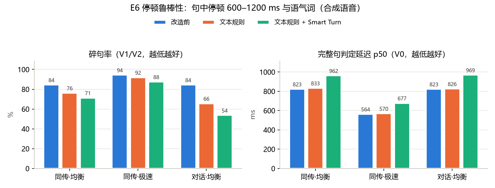

# 断句与实时字幕体验：改造前后对比（improve-speech-endpointing-and-live-ux 7.1–7.5）

- 时间：2026-10-06
- 代码：b943771（评测与链路验证）；识别 SenseVoice int8（本地），VAD silero，声学判定 Smart Turn v3.2 int8
- 数据：`evaluation/data/speech_pause/`，由 E4 的 40 句（zh / en / ja / ko 各 10 句，edge-tts 合成）派生 216 条
- 原始结果：`evaluation/results/multimodal/e6_runs.jsonl`（离线断句）、`e6_e2e.jsonl`（端到端抽检）、`e6_chain.json`（三端链路）
- 汇总：`e6_summary.md` / `e6_summary.csv`、`e6_e2e.csv`、`e6_latency.png`
- 结论基于合成语音的小规模数据，只作方向性参考；真人语音见文末"待用户验证"

## 结论

| 问题（用户反馈） | 改造前 | 改造后（缺省配置） | 说明 |
|---|---|---|---|
| 页面出现空白气泡 / 孤立光标 | 识别为空的语句残留带光标的气泡；会议室有只含指标的空白气泡 | **0**（三种视图各 30–40 s 采样，空白气泡 0、孤立光标 0，同时最多 1 个光标） | 撤回事件 + 前端只渲染有文字的语句 + 过期收尾 |
| 只说"嗯"、咳嗽也成句并翻译播报 | 语气词成句 1–6 次（E6） | **0**；"嗯……"经 Spring 下发 partial → hold → discard，不落库 | 语气词 / 噪声撤回 |
| AI 对话在停顿时抢答 | 停顿超过 500 ms 即回复；用户接着说会打断它，并在上下文里留下一条用户没听到的回复 | AI 回复开播前用户继续说：回复撤回（不写入记忆与记录），两段合并为一轮回应；没有续说则约 3 s 后恢复回应 | 回复让位（三端链路实测通过） |
| 咳嗽打断 AI | 任意 partial 都触发插话 | 去掉语气词后至少 2 字 / 1 词才触发 | 插话门槛 |
| 播报时把用户正在说的话掐断（半双工） | 播报一开始就关麦 | 用户正在说话或本句未定稿时推迟开播（最多 4 s） | 择机开播（单测与 mock 验证） |
| 句中停顿把一句话切碎 | 碎句率 84.4%（同传·均衡） | 76.2%（同传·均衡），65.6%（AI 对话） | 改善有限，见下文 |
| 完整句判定延迟 p50 | 823 ms | 833 ms（+10 ms） | 文本规则几乎没有额外延迟 |
| 两句之间 700 ms 间隔被误合并 | 0% | 0% | 没有引入误合并 |

缺省只启用文本规则：Smart Turn 没有达到预先约定的缺省开启标准（碎句率下降 ≥ 50% 且完整句延迟增加 ≤ 150 ms），
改为可选（`ENDPOINT_SMART_TURN=auto`）。

## E6 数据

| 变体 | 构造 | 样本 | 期望 |
|---|---|---|---|
| V0 原句 | 原始整句音频 | 40 | 1 个定稿（测完整句延迟） |
| V1 句中停顿 | 在 35%–65% 区间能量最低处切开原句，插入 600 / 900 / 1200 ms 静音 | 120 | 1 个定稿 |
| V2 停顿 + 语气词 | 切点插入合成的语气词（嗯…… / Um... / えーと / 음…），两侧各 300 ms 静音 | 40 | 1 个定稿 |
| V3 两句间隔 | 同场景相邻两句之间留 700 ms 静音 | 16 | 2 个定稿（测误合并） |

切点只由原音频决定，重复生成的音频与清单逐字节一致。切点类型：前半句末尾 ±1 个字词内有分句标点的为"分句边界"（14 句，如"大家好，"），
否则为"短语中间"（26 句，如"请问去…""大模型的推理成本…"）。分句边界处切开后前半句本身是完整分句，分开翻译可以接受；
"短语中间切点的碎句率"才是用户实际抱怨的半句。

## 离线断句评测（E6）

直接驱动断句组件（真实 VAD / 识别 / 声学模型，不调用 LLM），按音频时钟回放；判定延迟 = 最后一段语音结束 → 定稿，含识别与判定的计算耗时
（识别结果缓存复用，但按首次实测耗时记账，各组口径一致）。

| 组 | 档位 | 碎句率 | 短语中间切点 | 误合并率 | 语气词成句 | 完整句延迟 p50 / p90 (ms) |
|---|---|---|---|---|---|---|
| 改造前 | 同传·均衡 | 84.4% | 80.8% | 0% | 1 | 823 / 975 |
| 文本规则 | 同传·均衡 | 76.2% | 69.2% | 0% | 0 | 833 / 992 |
| 文本规则 + Smart Turn | 同传·均衡 | 71.3% | 63.5% | 0% | 0 | 962 / 1139 |
| 改造前 | 同传·极速 | 94.4% | 91.3% | 0% | 6 | 564 / 785 |
| 文本规则 | 同传·极速 | 91.9% | 87.5% | 0% | 0 | 570 / 789 |
| 文本规则 + Smart Turn | 同传·极速 | 87.5% | 82.7% | 0% | 0 | 677 / 899 |
| 改造前 | AI 对话·均衡 | 84.4% | 80.8% | 0% | 1 | 823 / 975 |
| 文本规则 | AI 对话·均衡 | 65.6% | 56.7% | 0% | 0 | 826 / 981 |
| 文本规则 + Smart Turn | AI 对话·均衡 | 53.7% | 44.2% | 0% | 0 | 969 / 1107 |



**阈值扫描**（文本规则 + Smart Turn）：

| 阈值 | 同传·均衡 碎句率 / 延迟 p50 | AI 对话·均衡 碎句率 / 延迟 p50 / 误合并率 |
|---|---|---|
| 0.5（缺省） | 71.3% / 962 ms | 53.7% / 969 ms / 0% |
| 0.9 | 68.1% / 1284 ms | 43.8% / 1237 ms / 0% |
| 0.95 | 63.7% / 1161 ms | 32.5% / 1386 ms / 6.2% |
| 0.98 | 59.4% / 1170 ms | 20.0% / 1124 ms / 18.8% |

**分析**

- **碎句率的下限由等待时长决定**：同传·均衡档最长等 500 + 700 = 1200 ms，1200 ms 的停顿按设计就会切开（V1 的三分之一）；
  极速档最长等 700 ms，三种停顿几乎都会切开。这是延迟与完整度的取舍，不是缺陷。
- **合成语音上声学模型区分度弱**：合成中文半句在逗号处也有降调，Smart Turn 给半句的完成概率普遍在 0.95–0.98，与整句（约 0.99）接近；
  阈值调高可以减少碎句，但完整句也被拦下（延迟 +300 ms 以上），0.95 起还会把两句误合并。
- **文本规则零代价**：只看结尾的连接词、虚词与语气词，抓住"我想问一下就是…""Let's move on to the…"一类半句，延迟几乎不变；
  AI 对话档的等待更长，收益更明显（短语中间切点的碎句率 80.8% → 56.7%）。"请问…""大模型的推理成本…"这类以名词或动词结尾的半句文本规则判断不了。
- **识别模型会给半句补句末标点**：探针中 20 个半句全部带"。"或"."，因此判定不依据标点。

**决定**：缺省 `endpoint_smart_turn=off`（只用文本规则）；阈值保持 0.5（开启时延迟 +110–150 ms，不引入误合并）；
同传·均衡档的候选静音保持 500 ms（不开声学模型时缩短静音只会更碎）。主要使用 AI 对话的场景可开启 Smart Turn。

## 端到端抽检

实时速度推流到 Python 同传端点（每条样本一条发言流，含真实 LLM 翻译与 edge-tts 合成），zh / en 各 5 句，缺省配置：

| 模式 | 变体 | 被切开的样本 | 每样本定稿数 | 每样本 AI 回复数 | e2e p50 / p90 (ms) | 整句 chrF |
|---|---|---|---|---|---|---|
| 同传收听 | V0 原句 | 2 / 10 | 1.2 | — | 3208 / 3689 | 52.3 |
| 同传收听 | V1 停顿 900 ms | 9 / 10 | 1.9 | — | 4032 / 5136 | 49.7 |
| AI 对话 | V0 原句 | 1 / 10 | 1.1 | 1.1 | 3394 / 3933 | — |
| AI 对话 | V1 停顿 900 ms | 9 / 10 | 1.9 | 1.8 | 3144 / 3931 | — |

- 抽检脚本不是浏览器，不会让位，所以 AI 对话中每次停顿都产生一条回复；浏览器中这种情况由回复让位处理（下节）。
- 停顿句被切开后整句 chrF 低 2.6 分；e2e 主要由 LLM 首字与 edge-tts 首包决定（与 E4 一致），续说等待平均只占 60–120 ms。
- 1 次 edge-tts 返回 HTTP 503（非致命，前端改用浏览器朗读），与本变更无关。

## 三端链路验证

经 Spring 对外接口（登录 → 创建会话 → `/ws/interpret`）实时推送 E6 音频（`eval.multimodal.e6_chain`），3 项全部通过：

| 场景 | 经 Spring 收到的事件 | 落库 |
|---|---|---|
| 同传收听只说"嗯……" | partial → partial(hold) → **transcript.discard** | 0 条 ✅ |
| 同传收听"请问去 \| 900 ms \| 火车站怎么走？" | final（请问。）→ partial → final（去火车站怎么走？） | 2 条，指标带 holdMs ✅ |
| AI 对话：回复开始后发 `interrupt{yield:true}` | …partial[ai] → **transcript.discard[ai]**，之后该 uid 没有任何事件；约 3 s 后恢复回应（新 uid） | 用户句与两条听到的 AI 回复，撤回的回复不在记录中 ✅ |

## 前端验证（mock 模式 + Playwright）

| 视图 | 采样 | 空白气泡 | 孤立光标 | 同时光标数 | 其他 |
|---|---|---|---|---|---|
| 会议室 | 30 s / 120 次 | 0 | 0 | ≤ 1 | 噪声"嗯"出现后被撤回；连续消息分组；上翻历史不被抢回，出现"新消息 · n" |
| AI 对话 | 45 s / 180 次 | 0 | 0 | ≤ 1 | 抢答的回复在用户续说时撤回，随后只回复一次；迟到的用户转写排在它触发的回复之前 |
| 收听 | 40 s / 160 次 | 0 | 0 | ≤ 1 | 停顿时显示呼吸点，开口未出字时显示"正在听" |

截图：`screenshots/`（会议室、新消息胶囊、AI 对话桌面版、AI 对话移动端暗色 + 减少动效、收听）。

## 仍未解决 / 局限

- **合成语音**：停顿与语调由 edge-tts 合成并人工插入静音，和真人犹豫（拖音、语气词、升调）不同；Smart Turn 用真人数据训练，真人语音上的结论可能更好。
- **以名词、动词结尾的半句**：如"请问…""大模型的推理成本…"，文本规则判断不了，缺省配置下仍会在停顿超过 500 ms 时切开。
- **短片段识别错误**：句首约 0.6 s 的"大家好"被单独识别时，SenseVoice（自动语种）识别为日语"あほ？"，翻译成 "Idiot?"。
  合并续说后对整段重识别可以纠正，但该片段被判为说完时仍会单独输出；识别器目前不使用声明的源语种，留作后续改进。
- **AI 对话的让位依赖前端**：服务端不知道回复是否已在客户端开播，所以由客户端判定；非浏览器客户端不会让位。

## 待用户验证（真人语音）

见 `manual.md`：在电脑浏览器与手机（`pnpm dev:lan` 的 https 地址）上真实说话，核对停顿续说、语气词、AI 抢答让位、半双工推迟开播与会议室显示。
如愿意录 10 句带自然停顿的真人语音（中英各 5 句）放到 `evaluation/data/speech_pause/human/`，可重跑 E6 验证 Smart Turn 在真人语音上的效果。

## 复现

```bash
cd python-backend
uv run python -m app.speech.download              # 含 Smart Turn 模型
uv run python -m scripts.endpoint_eval data       # 生成 E6 数据
uv run python -m scripts.endpoint_eval run        # 离线断句评测（约 20 分钟）
ENDPOINT_SMART_TURN_THRESHOLD=0.95 uv run python -m scripts.endpoint_eval run --groups smart --label smart-th95
uv run python -m scripts.endpoint_eval summary
cd ../evaluation
uv run python -m eval.multimodal.e6_plot
uv run python -m eval.multimodal.e6_e2e run       # 需要 Python 8000
uv run python -m eval.multimodal.e6_chain         # 需要 Python 8000 + Spring 18080
```
